<div align="center">

# FX Lab

**32 interactive WebGL2 & WebGPU graphics-effect sandboxes in plain ES modules — zero dependencies, zero build step.**

[**Launch Live Sandbox ↗**](https://gamedevpl.github.io/fx-lab/) · [gamedev.pl](https://www.gamedev.pl) · [YouTube](https://www.youtube.com/@gamedev_pl) · [Game Design Codex](https://github.com/gamedevpl/gdc) · [Lumen Lab](https://github.com/gamedevpl/silnik3d-od-zera/tree/main/docs/lumen-lab)


<br>

<a href="https://gamedevpl.github.io/fx-lab/">
  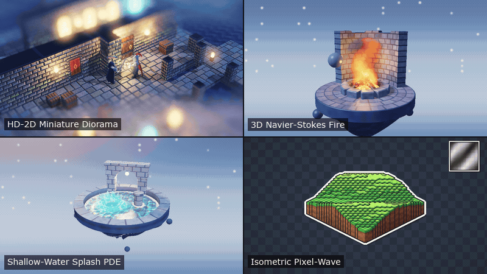
</a>

*Every effect runs live in your browser: orbit the camera, scrub through 5–8 historical eras, drag a real-time before/after split divider, and poke the physics.*

</div>

---

## Live before/after split-screen

Hit `S` or drag the amber divider in any scene to compare eras side by side in real time — from 1985 palette-cycling tricks straight through 2026 live GPU fluid & ray-tracing solvers.

<p align="center">
  <a href="https://gamedevpl.github.io/fx-lab/fire/?split=1">
    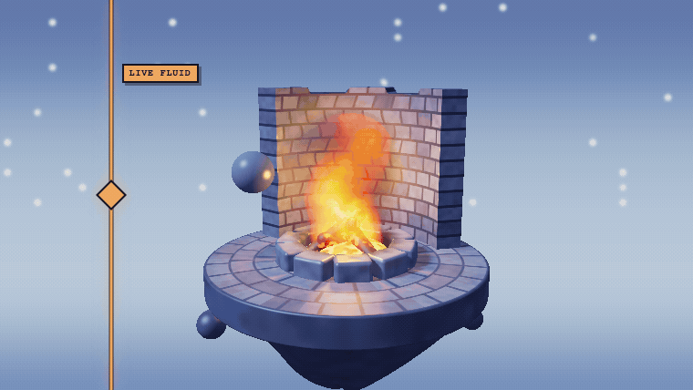
  </a>
</p>

---

## All 32 effects

Click any thumbnail to jump straight into that sandbox.

### Fluids, Volumetrics & Nature

<table>
  <tr>
    <td align="center" width="33%" valign="top">
      <a href="https://gamedevpl.github.io/fx-lab/fire/">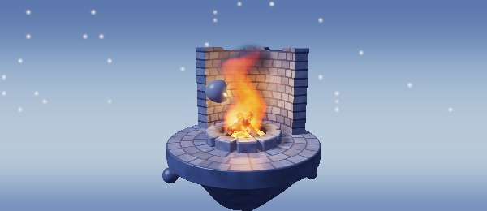</a><br>
      <b><a href="https://gamedevpl.github.io/fx-lab/fire/">Evolution of Fire</a></b> · 8 eras<br>
      <sub>1985 CLUT &amp; PSX Doom fire up to a live 3D Navier–Stokes fluid solver.</sub><br>
      <sub><a href="./docs/effects/fire/">Code &amp; notes</a> · <a href="https://www.youtube.com/shorts/KbYwPNdl8Hs">Short ↗</a></sub>
    </td>
    <td align="center" width="33%" valign="top">
      <a href="https://gamedevpl.github.io/fx-lab/water/">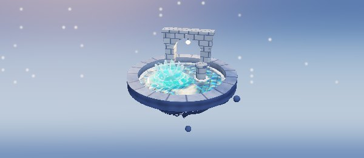</a><br>
      <b><a href="https://gamedevpl.github.io/fx-lab/water/">Evolution of Water</a></b> · 8 eras<br>
      <sub>Beer–Lambert depth, Gerstner waves, RGB caustics, and a live 128² splash PDE.</sub><br>
      <sub><a href="./docs/effects/water/">Code &amp; notes</a> · <a href="https://www.youtube.com/shorts/x3HO4xdl5Zs">Short ↗</a></sub>
    </td>
    <td align="center" width="33%" valign="top">
      <a href="https://gamedevpl.github.io/fx-lab/clouds/">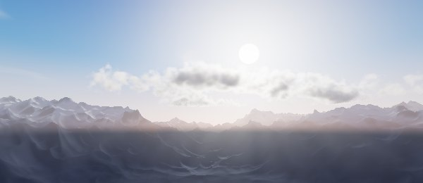</a><br>
      <b><a href="https://gamedevpl.github.io/fx-lab/clouds/">Clouds &amp; Sky</a></b> · 8 eras<br>
      <sub>Sprite skies to Rayleigh/Mie atmosphere, 64³ Perlin–Worley raymarching &amp; god-rays.</sub><br>
      <sub><a href="./docs/effects/clouds/">Code &amp; notes</a> · <a href="https://www.youtube.com/shorts/ms-mbMSgG9A">Short ↗</a></sub>
    </td>
  </tr>
  <tr>
    <td align="center" width="33%" valign="top">
      <a href="https://gamedevpl.github.io/fx-lab/grass/">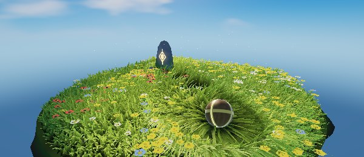</a><br>
      <b><a href="https://gamedevpl.github.io/fx-lab/grass/">Grass &amp; Foliage</a></b> · 8 eras<br>
      <sub>X-cards &amp; shell grass to 28,000 instanced blades with interactive trampling trails.</sub><br>
      <sub><a href="./docs/effects/grass/">Code &amp; notes</a> · <a href="https://www.youtube.com/shorts/DnuMky0yNu0">Short ↗</a></sub>
    </td>
    <td align="center" width="33%" valign="top">
      <a href="https://gamedevpl.github.io/fx-lab/fog/">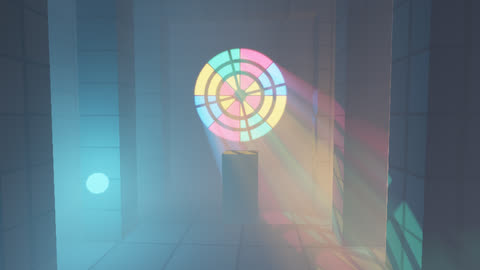</a><br>
      <b><a href="https://gamedevpl.github.io/fx-lab/fog/">Fog &amp; Volumetrics</a></b> · 8 eras<br>
      <sub>Silent Hill depth fog to radial god-rays, temporal froxels &amp; stained-glass sunbeams.</sub><br>
      <sub><a href="./docs/effects/fog/">Code &amp; notes</a> · <a href="https://www.youtube.com/shorts/7DkkkWPEO8A">Short ↗</a></sub>
    </td>
    <td align="center" width="33%" valign="top">
      <a href="https://gamedevpl.github.io/fx-lab/terrain/">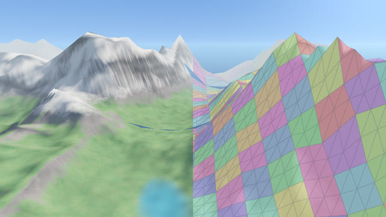</a><br>
      <b><a href="https://gamedevpl.github.io/fx-lab/terrain/">Terrain &amp; LOD</a></b> · 8 eras<br>
      <sub>Comanche Voxel Space &amp; GeoMipMapping cracks up to CDLOD and Nanite-style meshlets.</sub><br>
      <sub><a href="./docs/effects/terrain/">Code</a></sub>
    </td>
  </tr>
</table>

### Lighting, Shadows & Materials

<table>
  <tr>
    <td align="center" width="33%" valign="top">
      <a href="https://gamedevpl.github.io/fx-lab/shadows/">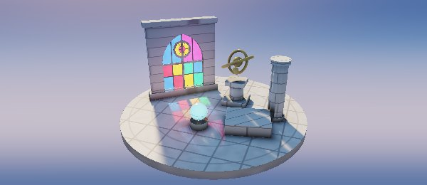</a><br>
      <b><a href="https://gamedevpl.github.io/fx-lab/shadows/">Evolution of Shadows</a></b> · 8 eras<br>
      <sub>Blob discs, Doom 3 stencil volumes, 88² shadow maps, PCSS &amp; stained-glass GI.</sub><br>
      <sub><a href="./docs/effects/shadows/">Code &amp; notes</a> · <a href="https://www.youtube.com/shorts/AaOwo3sHVRk">Short ↗</a></sub>
    </td>
    <td align="center" width="33%" valign="top">
      <a href="https://gamedevpl.github.io/fx-lab/gi/">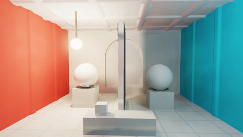</a><br>
      <b><a href="https://gamedevpl.github.io/fx-lab/gi/">Global Illumination</a></b> · WebGPU<br>
      <sub>Quake lightmaps &amp; probe leaks to Voxel Cone Tracing, DDGI &amp; Radiance Cascades.</sub><br>
      <sub><a href="./docs/effects/gi/">Code &amp; notes</a> · <a href="https://www.youtube.com/shorts/JnQ5xxRjIkE">Short ↗</a></sub>
    </td>
    <td align="center" width="33%" valign="top">
      <a href="https://gamedevpl.github.io/fx-lab/pathtracing/">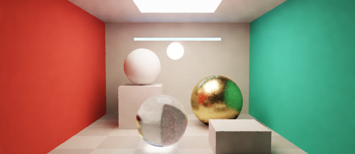</a><br>
      <b><a href="https://gamedevpl.github.io/fx-lab/pathtracing/">Path Tracing</a></b> · 8 eras<br>
      <sub>Blinn–Phong &amp; Whitted rays to Monte Carlo MIS, ReSTIR &amp; SVGF denoising.</sub><br>
      <sub><a href="./docs/effects/pathtracing/">Code &amp; notes</a> · <a href="https://www.youtube.com/shorts/lKV2oTqJ0RU">Short ↗</a></sub>
    </td>
  </tr>
  <tr>
    <td align="center" width="33%" valign="top">
      <a href="https://gamedevpl.github.io/fx-lab/reflections/">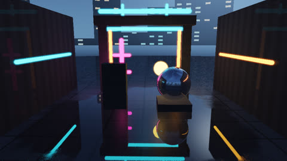</a><br>
      <b><a href="https://gamedevpl.github.io/fx-lab/reflections/">Reflections</a></b> · 8 eras<br>
      <sub>Portal mirrors, cubemaps, SSR holes, split-sum IBL &amp; multi-bounce glossy RT.</sub><br>
      <sub><a href="./docs/effects/reflections/">Code &amp; notes</a> · <a href="https://www.youtube.com/shorts/ySQLiscu4U4">Short ↗</a></sub>
    </td>
    <td align="center" width="33%" valign="top">
      <a href="https://gamedevpl.github.io/fx-lab/glass/">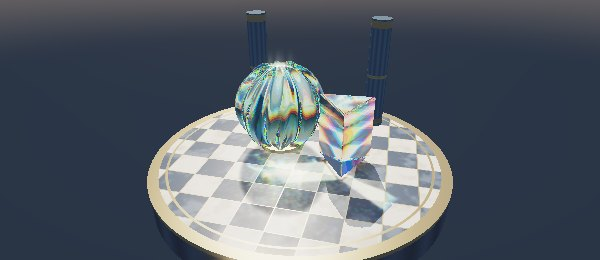</a><br>
      <b><a href="https://gamedevpl.github.io/fx-lab/glass/">Glass &amp; Caustics</a></b> · 8 eras<br>
      <sub>Flat alpha to Snell refraction, dispersion &amp; 98K spectral caustic photons.</sub><br>
      <sub><a href="./docs/effects/glass/">Code &amp; notes</a> · <a href="https://www.youtube.com/shorts/T2alevyW7Bo">Short ↗</a></sub>
    </td>
    <td align="center" width="33%" valign="top">
      <a href="https://gamedevpl.github.io/fx-lab/materials/">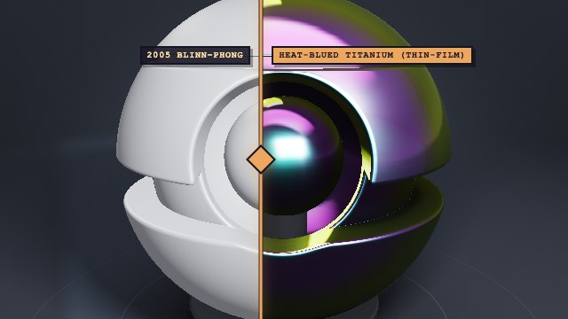</a><br>
      <b><a href="https://gamedevpl.github.io/fx-lab/materials/">Material Sandbox</a></b> · 6 PBR shaders<br>
      <sub>5 live sliders, draggable softbox &amp; split vs 2005 Phong: clay, brushed steel, flake paint, velvet, titanium.</sub><br>
      <sub><a href="./docs/effects/materials/">Code &amp; notes</a></sub>
    </td>
  </tr>
  <tr>
    <td align="center" width="33%" valign="top">
      <a href="https://gamedevpl.github.io/fx-lab/skin/">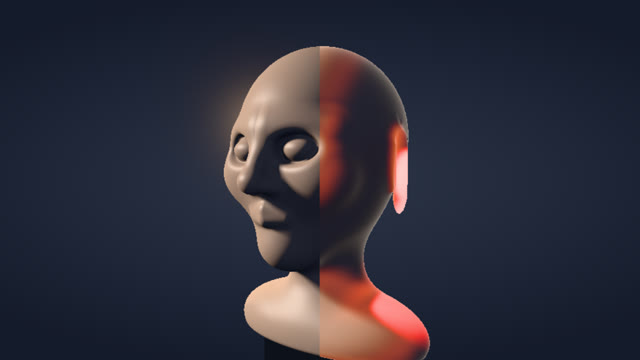</a><br>
      <b><a href="https://gamedevpl.github.io/fx-lab/skin/">Skin &amp; Subsurface Scattering</a></b> · 8 eras<br>
      <sub>Plastic Phong to Dipole BSSRDF, Separable SSS, Burley diffusion &amp; backlit ears.</sub><br>
      <sub><a href="./docs/effects/skin/">Code</a></sub>
    </td>
    <td align="center" width="33%" valign="top">
      <a href="https://gamedevpl.github.io/fx-lab/tonemapping/">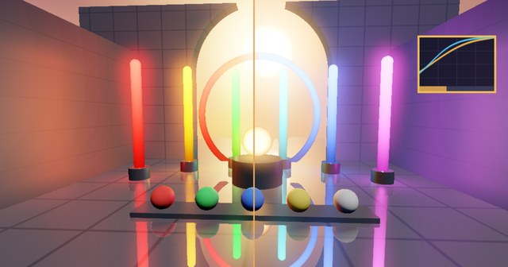</a><br>
      <b><a href="https://gamedevpl.github.io/fx-lab/tonemapping/">Tone Mapping &amp; HDR</a></b> · 8 eras<br>
      <sub>True RGBA16F neon alley with live EV drag: LDR clip, Reinhard, ACES, AgX &amp; PBR Neutral.</sub><br>
      <sub><a href="./docs/effects/tonemapping/">Code</a> · <a href="https://www.youtube.com/shorts/O_lfxUgcVkY">Short ↗</a></sub>
    </td>
    <td align="center" width="33%" valign="top">
      <a href="https://gamedevpl.github.io/fx-lab/surface/">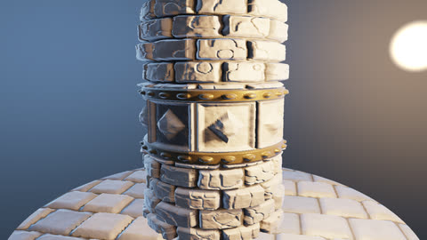</a><br>
      <b><a href="https://gamedevpl.github.io/fx-lab/surface/">Surface Detail</a></b> · 8 eras<br>
      <sub>Bump, normal &amp; Parallax Occlusion Mapping vs true DX11 displacement &amp; meshlets.</sub><br>
      <sub><a href="./docs/effects/surface/">Code &amp; notes</a> · <a href="https://www.youtube.com/shorts/22nWrL2uBKc">Short ↗</a></sub>
    </td>
  </tr>
</table>

### Stylization, Pixel Art & Non-Photorealistic

<table>
  <tr>
    <td align="center" width="33%" valign="top">
      <a href="https://gamedevpl.github.io/fx-lab/hd2d/">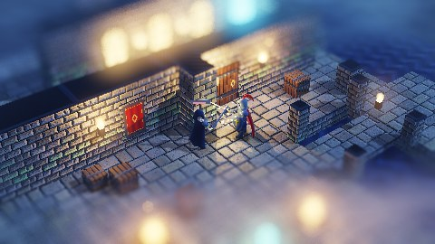</a><br>
      <b><a href="https://gamedevpl.github.io/fx-lab/hd2d/">HD-2D Miniature Diorama</a></b> · 8 steps<br>
      <sub>Pixel normal maps, 12 HDR point lights, bloom &amp; tilt-shift Scheimpflug bokeh.</sub><br>
      <sub><a href="./docs/effects/hd2d/">Code &amp; notes</a></sub>
    </td>
    <td align="center" width="33%" valign="top">
      <a href="https://gamedevpl.github.io/fx-lab/splats/">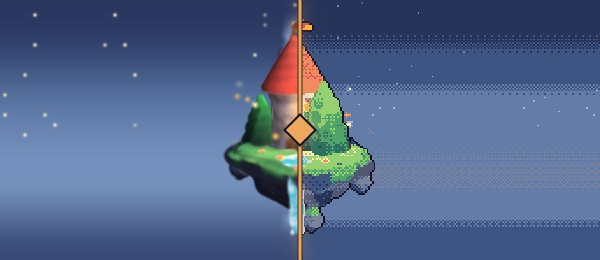</a><br>
      <b><a href="https://gamedevpl.github.io/fx-lab/splats/">Pixel-Art Gaussian Splats</a></b> · 5 steps<br>
      <sub>3D Gaussian surfels snapped to a pixel grid with 24-color palette voting &amp; 1 px ink.</sub><br>
      <sub><a href="./docs/effects/splats/">Code &amp; notes</a> · <a href="https://www.youtube.com/shorts/_XPeSD0esb8">Short ↗</a></sub>
    </td>
    <td align="center" width="33%" valign="top">
      <a href="https://gamedevpl.github.io/fx-lab/pixelwave/">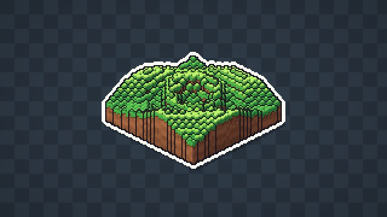</a><br>
      <b><a href="https://gamedevpl.github.io/fx-lab/pixelwave/">Isometric Pixel-Wave Toy</a></b> · 5 steps<br>
      <sub>2D noise turned into 2:1 isometric voxel waves, click ripples &amp; vinyl sticker outline.</sub><br>
      <sub><a href="./docs/effects/pixelwave/">Code &amp; notes</a></sub>
    </td>
  </tr>
  <tr>
    <td align="center" width="33%" valign="top">
      <a href="https://gamedevpl.github.io/fx-lab/ascii/">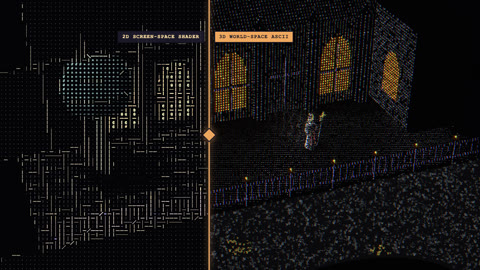</a><br>
      <b><a href="https://gamedevpl.github.io/fx-lab/ascii/">3D World-Space ASCII</a></b> · 8 steps<br>
      <sub>42,000+ instanced 3D glyph billboards that stay razor-sharp even at 7.4× zoom.</sub><br>
      <sub><a href="./docs/effects/ascii/">Code</a></sub>
    </td>
    <td align="center" width="33%" valign="top">
      <a href="https://gamedevpl.github.io/fx-lab/pixel3d/">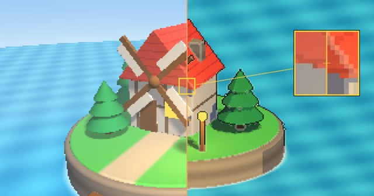</a><br>
      <b><a href="https://gamedevpl.github.io/fx-lab/pixel3d/">3D Pixel Art</a></b> · 8 eras<br>
      <sub>Voxel Space, DKC sprites, Obra Dinn 1-bit &amp; texel-snapped cameras with a 4× loupe.</sub><br>
      <sub><a href="./docs/effects/pixel3d/">Code</a> · <a href="https://www.youtube.com/shorts/BQ37q7o_rtM">Short ↗</a></sub>
    </td>
    <td align="center" width="33%" valign="top">
      <a href="https://gamedevpl.github.io/fx-lab/dithering/">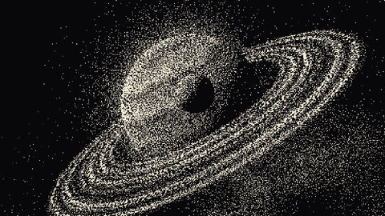</a><br>
      <b><a href="https://gamedevpl.github.io/fx-lab/dithering/">Dithering &amp; 1-Bit Stippling</a></b> · 8 eras<br>
      <sub>Bayer matrices, Floyd–Steinberg, Atkinson, PS1 RGB555 &amp; surface-locked blue noise.</sub><br>
      <sub><a href="./docs/effects/dithering/">Code &amp; notes</a></sub>
    </td>
  </tr>
  <tr>
    <td align="center" width="33%" valign="top">
      <a href="https://gamedevpl.github.io/fx-lab/toon/">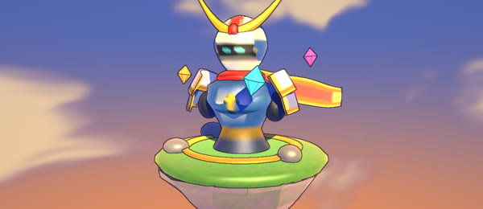</a><br>
      <b><a href="https://gamedevpl.github.io/fx-lab/toon/">Toon &amp; NPR Shading</a></b> · 8 eras<br>
      <sub>Inverted-hull cel, Gooch, Guilty Gear Xrd, Spider-Verse halftones &amp; Kuwahara oil paint.</sub><br>
      <sub><a href="./docs/effects/toon/">Code &amp; notes</a> · <a href="https://www.youtube.com/shorts/jityemaHGLc">Short ↗</a></sub>
    </td>
    <td align="center" width="33%" valign="top">
      <a href="https://gamedevpl.github.io/fx-lab/portals/">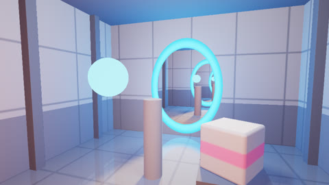</a><br>
      <b><a href="https://gamedevpl.github.io/fx-lab/portals/">Portals &amp; Impossible Spaces</a></b> · 8 eras<br>
      <sub>Build-engine sectors, recursive Portal corridors, non-Euclidean rooms &amp; Viewfinder 3D stamps.</sub><br>
      <sub><a href="./docs/effects/portals/">Code &amp; notes</a> · <a href="https://www.youtube.com/shorts/luQ7DI7gWmg">Short ↗</a></sub>
    </td>
    <td align="center" width="33%" valign="top">
      <a href="https://gamedevpl.github.io/fx-lab/textures/">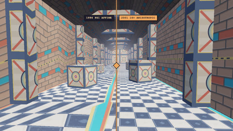</a><br>
      <b><a href="https://gamedevpl.github.io/fx-lab/textures/">Texture Mapping</a></b> · 8 eras<br>
      <sub>PS1 affine warping, Voodoo bilinear, S3TC 4×4 blocks, 16× AF &amp; MegaTexture streaming.</sub><br>
      <sub><a href="./docs/effects/textures/">Code &amp; notes</a> · <a href="https://www.youtube.com/shorts/X13_VuMJKmA">Short ↗</a></sub>
    </td>
  </tr>
</table>

### Physics, Animation & Camera Post-FX

<table>
  <tr>
    <td align="center" width="33%" valign="top">
      <a href="https://gamedevpl.github.io/fx-lab/cloth/">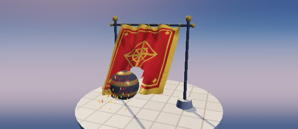</a><br>
      <b><a href="https://gamedevpl.github.io/fx-lab/cloth/">Evolution of Cloth</a></b> · 8 eras<br>
      <sub>2-frame pixel banners to Verlet springs, velvet sheen, XPBD wrapping &amp; live tearing.</sub><br>
      <sub><a href="./docs/effects/cloth/">Code &amp; notes</a> · <a href="https://www.youtube.com/shorts/R_xwfoOKS3I">Short ↗</a></sub>
    </td>
    <td align="center" width="33%" valign="top">
      <a href="https://gamedevpl.github.io/fx-lab/fur/">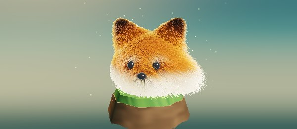</a><br>
      <b><a href="https://gamedevpl.github.io/fx-lab/fur/">Evolution of Fur</a></b> · 8 eras<br>
      <sub>Shell texturing, Marschner scattering, 30K 3D strands &amp; click-to-pet wind dynamics.</sub><br>
      <sub><a href="./docs/effects/fur/">Code &amp; notes</a> · <a href="https://www.youtube.com/shorts/PtXzuqlUVnY">Short ↗</a></sub>
    </td>
    <td align="center" width="33%" valign="top">
      <a href="https://gamedevpl.github.io/fx-lab/destruction/">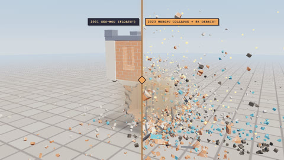</a><br>
      <b><a href="https://gamedevpl.github.io/fx-lab/destruction/">Destruction &amp; Fracturing</a></b> · WebGPU<br>
      <sub>Blast one watchtower across 8 eras: gib swaps, Geo-Mod, Voronoi &amp; Teardown voxels.</sub><br>
      <sub><a href="./docs/effects/destruction/">Code</a></sub>
    </td>
  </tr>
  <tr>
    <td align="center" width="33%" valign="top">
      <a href="https://gamedevpl.github.io/fx-lab/collisions/">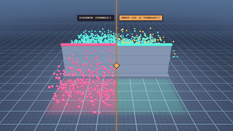</a><br>
      <b><a href="https://gamedevpl.github.io/fx-lab/collisions/">Collisions &amp; Tunneling</a></b> · WebGPU<br>
      <sub>Doom's directional clipping bug, BSP hulls, speculative contacts &amp; 4,096-bullet Swept CCD.</sub><br>
      <sub><a href="./docs/effects/collisions/">Code</a></sub>
    </td>
    <td align="center" width="33%" valign="top">
      <a href="https://gamedevpl.github.io/fx-lab/animation/">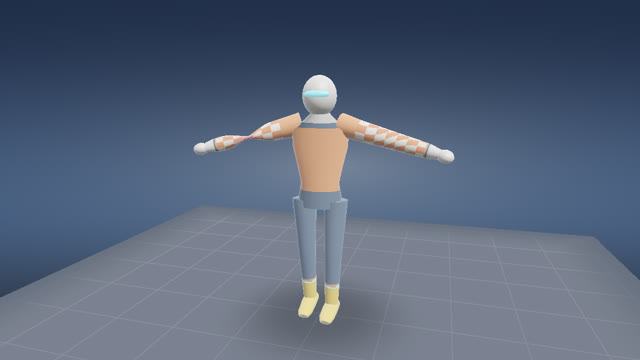</a><br>
      <b><a href="https://gamedevpl.github.io/fx-lab/animation/">Character Animation</a></b> · 8 eras<br>
      <sub>Rotoscoped sprites, LBS candy-wrapper twist, Foot IK, Dual Quaternions &amp; Motion Matching.</sub><br>
      <sub><a href="./docs/effects/animation/">Code</a></sub>
    </td>
    <td align="center" width="33%" valign="top">
      <a href="https://gamedevpl.github.io/fx-lab/aa/">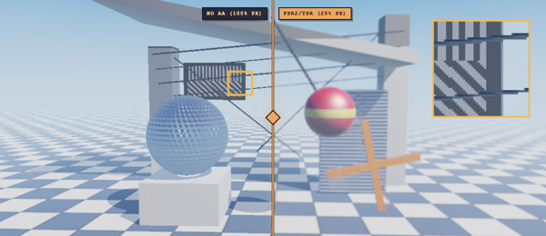</a><br>
      <b><a href="https://gamedevpl.github.io/fx-lab/aa/">Anti-Aliasing &amp; Upscaling</a></b> · 8 eras<br>
      <sub>SSAA, MSAA, FXAA, SMAA, TAA ghosting, YCoCg clamping &amp; FSR2/TSR with a 4× loupe.</sub><br>
      <sub><a href="./docs/effects/aa/">Code &amp; notes</a> · <a href="https://www.youtube.com/shorts/UizNrqtLYAs">Short ↗</a></sub>
    </td>
  </tr>
  <tr>
    <td align="center" width="33%" valign="top">
      <a href="https://gamedevpl.github.io/fx-lab/motionblur/">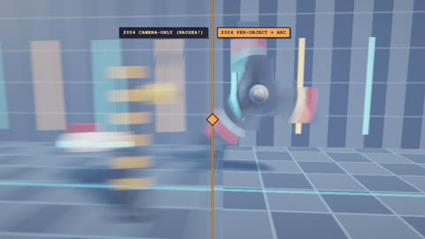</a><br>
      <b><a href="https://gamedevpl.github.io/fx-lab/motionblur/">Motion Blur</a></b> · 8 eras<br>
      <sub>Frame trails to McGuire TileMax/NeighborMax, Soft-Z depth &amp; live velocity buffer view.</sub><br>
      <sub><a href="./docs/effects/motionblur/">Code</a></sub>
    </td>
    <td align="center" width="33%" valign="top">
      <a href="https://gamedevpl.github.io/fx-lab/dof/">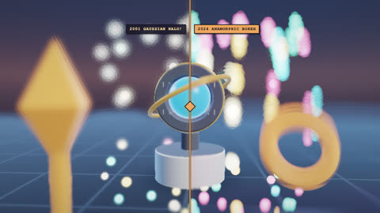</a><br>
      <b><a href="https://gamedevpl.github.io/fx-lab/dof/">Depth of Field &amp; Bokeh</a></b> · 8 eras<br>
      <sub>MGS2 halo bleed to hexagonal apertures, cat's-eye vignetting &amp; 2× anamorphic bokeh.</sub><br>
      <sub><a href="./docs/effects/dof/">Code</a></sub>
    </td>
    <td align="center" width="33%" valign="middle">
      <b>Want to poke the code?</b><br><br>
      <sub>Every effect lives in a standalone folder under <a href="./docs/effects/"><code>docs/effects/&lt;id&gt;/</code></a> with raw GLSL/WGSL shaders and zero external packages.</sub>
    </td>
  </tr>
</table>

---

## Controls

| Input | Action |
| --- | --- |
| **Drag** / **Scroll** | Orbit camera / zoom (`R` or double-click resets) |
| **`←` / `→`** | Step backward / forward across eras or passes |
| **`S`** or drag divider | Toggle & slide live before/after split comparison |
| **`E`** / **`1`–`9`** | Open effects catalog / jump directly to an effect |
| **Click scene** | Interact (ripples, aim sun, fire shell, move focus, pet fur…) |
| **`Space`** · **`M`** · **`B`** | Pause/resume · Web Audio SFX · background music |

---

## Running locally

No `npm install`, no bundler — just serve `docs/`:

```sh
python3 -m http.server 8080 --directory docs
```

Then open <http://localhost:8080/>.

<details>
<summary><b>Project layout</b> (all 32 self-contained effect modules)</summary>

```text
docs/
├── index.html          # Root shell (clean routes: /splats/, /fire/, /water/, …, /pixelwave/)
├── src/                # App shell, bilingual catalog, WebGL2 utilities, Web Audio engine
├── thumbs/             # Per-effect preview thumbnails
└── effects/<id>/       # Self-contained shader + simulation + renderer (+ README.md notes)
```

WebGPU compute demos (`gi`, `destruction`, `collisions`) ship both WGSL compute pipelines and automatic WebGL2 fallbacks (`?renderer=webgl2`).

</details>

---

## More interactive labs from [gamedev.pl](https://www.gamedev.pl)

- **[Game Design Codex (GDC)](https://github.com/gamedevpl/gdc)** — 22 playable 3D mini-games exposing hidden game-design tricks (Coyote Time, Hitstop, Attack Tokens, Rubber Banding, AI Director…)
- **[Lumen Lab](https://github.com/gamedevpl/silnik3d-od-zera/tree/main/docs/lumen-lab)** — 40 years of light and shadow in one single WebGL2 scene
- **[Neon Canal (Demko)](https://github.com/gamedevpl/silnik3d-od-zera/tree/main/demko)** — 3D C++ / WebAssembly / Metal neon racer
- **[Silnik 3D w C++ od zera](https://github.com/gamedevpl/silnik3d-od-zera)** — building a 3D C++ & OpenGL engine from an empty folder

## License

MIT — see [LICENSE](./LICENSE).
